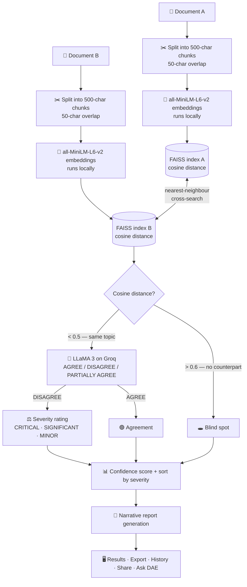

<div align="center">

```
██████╗  █████╗ ███████╗
██╔══██╗██╔══██╗██╔════╝
██║  ██║███████║█████╗
██║  ██║██╔══██║██╔══╝
██████╔╝██║  ██║███████╗
╚═════╝ ╚═╝  ╚═╝╚══════╝
```

# DAE — Data Analyser Engine

### Two documents go in. The truth comes out.

**An AI-powered engine that reads two (or up to five) documents side by side and tells you where they agree, where they contradict, and what each one forgot to mention.**

<br>


</div>

---

## ⚡ The 10-second pitch

You have two versions of a contract. Or two research papers. Or last year's policy and this year's.
Reading both line by line is slow, and `diff` only tells you *words* changed, not whether the *meaning* did.

DAE reads them the way a careful analyst would:

```
 Doc A  ▸ "The employee shall provide thirty (30) days written notice..."
 Doc B  ▸ "A minimum notice period of fourteen (14) days is required..."

 ┌──────────────────────────────────────────────────────────────┐
 │  ✖ DISAGREE · SEVERITY: CRITICAL · CONFIDENCE: 87%           │
 │  Notice period differs: 30 days in Doc A vs 14 days in Doc B │
 └──────────────────────────────────────────────────────────────┘
```

No keyword matching. DAE finds the passages that are *about the same thing* using vector search, then lets an LLM judge whether they actually agree.

---

## ✨ Features

| | |
|---|---|
| 🔴 **Contradiction detection** | Side-by-side evidence with a verdict, a one-line reason and a **CRITICAL / SIGNIFICANT / MINOR** severity rating |
| 🟢 **Agreement mapping** | Passages where both documents are aligned, and where they only *partially* agree |
| 🕳️ **Blind-spot discovery** | Topics one document covers that the other never mentions, reported for each side |
| 📊 **Confidence scores** | Every finding gets a 0–99 score built from similarity, verdict clarity, context length and reason quality |
| 📝 **Narrative report** | An LLM-written analysis with six sections: Overview, Key Findings, Contradictions, Agreements, Blind Spots, Conclusion |
| 📡 **Live streaming analysis** | Server-Sent Events push progress and findings to the UI *as they are discovered*, with live counters |
| 📚 **Multi-document mode** | Compare **2 to 5 documents** in a single run |
| 🔥 **Token heatmap** | Shared terms are highlighted across both sides of each finding; hover to see matching words light up |
| 💬 **Ask DAE** | A Q&A chat that answers follow-up questions about your analysis |
| 🕰️ **Full history** | Every analysis is saved and can be reopened later |
| 🔗 **Shareable links** | Send a result to someone with a single `/share/<id>` link |
| 📦 **Export anywhere** | Download results as **PDF**, **JSON** or **TXT** |
| 🌗 **Dark / light theme** | Remembered between visits |
| 🕹️ **Retro-futuristic UI** | Pixel-terminal styling, an aurora canvas background, a vortex animation and a live clock |

---

## 🧠 How it works

DAE uses a **dual-vector RAG architecture**: one vector index *per document*, queried against each other.



### The pipeline, step by step

1. **Load.** PDFs are read with PyPDF, DOCX with `python-docx`, and TXT as UTF-8.
2. **Chunk.** `RecursiveCharacterTextSplitter` cuts each document into 500-character chunks with a 50-character overlap.
3. **Embed.** Each chunk becomes a vector using `all-MiniLM-L6-v2`, which runs **locally** and needs no API call.
4. **Index.** Two separate FAISS indexes are built, one per document, using cosine distance.
5. **Cross-search.** Every chunk in A looks up its single nearest neighbour in B's index. B is then searched against A in the same way to find blind spots.
6. **Judge.** Pairs that are close enough to be about the same topic (distance `< 0.5`) are sent to **LLaMA 3 on Groq**, which answers in a strict `VERDICT` / `REASON` format.
7. **Rate.** Every `DISAGREE` gets a second, single-word severity pass: `CRITICAL`, `SIGNIFICANT` or `MINOR`.
8. **Detect gaps.** Chunks with no close counterpart in the other document (distance `> 0.6`) are flagged as **blind spots**.
9. **Score.** A transparent heuristic produces a confidence value for each finding (see below).
10. **Narrate.** The findings are handed to the LLM to write a structured six-section report.
11. **Save.** The full result is written to history, ready to reopen, export or share.

### 🎯 How confidence is calculated

Confidence is **not** a black box. It is a points system you can read in `calculate_confidence()`:

| Factor | Max points | What it rewards |
|---|:---:|---|
| Semantic closeness | 40 | Lower cosine distance means the two passages are clearly about the same thing |
| Verdict clarity | 30 | A clean `DISAGREE` or `AGREE` beats a hedged `PARTIALLY AGREE` |
| Context length | 20 | Longer excerpts give the model more to reason with |
| Reason specificity | 10 | A detailed explanation beats a vague one |

The total is capped at **99**, because nothing here deserves 100%.

---

## 🖥️ Pages

| Route | What you'll find |
|---|---|
| `/` | Animated landing page with an interactive "see it in action" example |
| `/dashboard` | The analysis console: drag-and-drop upload, standard and multi-doc modes, live progress, live counters |
| `/results` | Side-by-side findings, token heatmap, narrative report, export buttons, Ask DAE chat |
| `/history` | Every past analysis, reopenable, with one-click share links |
| `/share/<id>` | A read-only link to a saved result |

---

## 🚀 Quick start

```bash
# 1. Clone
git clone https://github.com/Haripriya24071/DAE.git
cd DAE/DAE

# 2. Create a virtual environment
python -m venv venv
venv\Scripts\activate          # Windows
source venv/bin/activate       # macOS / Linux

# 3. Install dependencies
pip install -r requirements.txt

# 4. Add your Groq API key
echo GROQ_API_KEY=your_key_here > .env

# 5. Run
python app.py
```

Then open **http://localhost:5000** 🎉

> 💡 The first run downloads the `all-MiniLM-L6-v2` embedding model from HuggingFace, so it takes a little longer. After that it is cached locally.
> 🔑 Get a free API key at [console.groq.com](https://console.groq.com).

### ✅ Health check

Visit `/api/check` to confirm your Groq key is picked up, or `/api/test-analyze` to run a tiny end-to-end test (embeddings → FAISS → LLM) before analysing real documents.

### 🧪 Try it from the command line

`compare.py` is a lightweight, **no-LLM baseline**. It extracts text with PyMuPDF, computes TF-IDF cosine similarity, and produces a line-level diff:

```bash
python compare.py doc1.pdf doc2.pdf
# Overall Similarity: xx.xx%
# Stats: {'added_count': ..., 'removed_count': ..., 'modified_count': ..., 'unchanged_count': ...}
```

Two sample PDFs, `doc1.pdf` and `doc2.pdf`, are included so you can try it immediately.

---

## 🔌 API

| Method | Endpoint | Purpose |
|---|---|---|
| `POST` | `/analyze-stream` | Compare two docs (`doc_a`, `doc_b`) and **stream** progress and findings over SSE. Also reachable as `/analyze` and `/compare` |
| `POST` | `/analyze-multi` | Compare 2–5 docs (`doc_1` … `doc_5`) |
| `POST` | `/analyze-legacy` | Non-streaming, single-response variant |
| `POST` | `/ask` | Ask a question about a saved analysis. Body: `{ "question": "...", "entry_id": "..." }` |
| `GET` | `/download/pdf` · `/download/json` · `/download/txt` | Export the current result |
| `GET` | `/history` · `/history/<id>` | Browse saved analyses |
| `POST` | `/clear-history` | Wipe saved history |
| `GET` | `/api/check` | Environment and key diagnostics |

**Streaming protocol.** The stream emits `progress` events (`step`, `total`, `message`, `percent`), then a final `complete` event carrying a `redirect_url` and a summary of contradictions, agreements, blind spots and chunk counts. Failures arrive as an `error` event.

---

## 🗂️ Project structure

```
DAE/
├── app.py                 # Flask app: routes, RAG pipeline, severity, confidence, narrative, exports
├── compare.py             # Standalone TF-IDF + difflib baseline comparator (CLI)
├── requirements.txt
├── Procfile               # gunicorn entry point
├── vercel.json            # Vercel serverless routing
├── api/
│   └── index.py           # WSGI entry point for Vercel
├── templates/
│   ├── base.html          # Shared layout, nav, theme toggle, live clock
│   ├── home.html          # Landing page with interactive demo
│   ├── dashboard.html     # Upload and analysis console
│   ├── results.html       # Findings, heatmap, narrative, Ask DAE
│   └── history.html       # Saved analyses
├── static/
│   ├── style.css          # Main design system
│   ├── pixel.css          # Retro pixel-art utilities
│   ├── base.js            # Theme, cursor canvas, aurora background
│   ├── home.js            # Landing-page hero animation
│   ├── dashboard.js       # Upload state machine + SSE stream reader
│   ├── results.js         # Token heatmap, tooltips, share, Q&A
│   ├── history.js         # History actions and share links
│   └── main.js
├── uploads/               # Runtime uploads (git-ignored)
├── history/               # Saved analyses (git-ignored)
├── doc1.pdf               # Sample document A
└── doc2.pdf               # Sample document B
```

---

## ☁️ Deployment

**Gunicorn (Heroku-style):** the included `Procfile` runs

```
web: gunicorn app:app --workers 1 --threads 8 --timeout 120
```

**Vercel:** `vercel.json` routes everything through `api/index.py`. When the `VERCEL` environment variable is detected, DAE automatically switches uploads and history to `/tmp`. Set `GROQ_API_KEY` in your project's environment variables.

---

## 🛠️ Tech stack

| Layer | Tools |
|---|---|
| **Backend** | Python, Flask, Gunicorn |
| **RAG and AI** | LangChain, FAISS (CPU), HuggingFace `all-MiniLM-L6-v2`, Groq-hosted LLaMA 3 |
| **Document parsing** | PyPDF / PyMuPDF, python-docx |
| **Classical NLP** | scikit-learn (TF-IDF), NLTK, `difflib` |
| **Exports** | ReportLab (PDF) |
| **Frontend** | Vanilla JavaScript, HTML5 Canvas, hand-written CSS, Server-Sent Events |

---

## 🔍 Design notes and honest limitations

Good engineering means knowing where the edges are.

- **Nearest-neighbour matching (`k=1`).** Each chunk is compared against its single best counterpart, which keeps the number of LLM calls manageable. A passage that conflicts with a *second-best* match won't be flagged.
- **Results are capped** to the top 10 contradictions, top 10 agreements and 5 blind spots per document, with contradictions sorted by severity.
- **Distance thresholds are tuned heuristics** (`< 0.5` same topic, `> 0.6` uncovered). They suit typical prose, but very short or highly technical documents may want different values.
- **Ask DAE answers from the analysis results** (findings and report), not by re-reading the raw documents. If something isn't in the analysis, it says so.
- **Upload limit:** 16 MB per request. Supported formats: PDF, DOCX, TXT.
- **On Vercel, history lives in `/tmp`**, so it is ephemeral between cold starts. Use a persistent host or add a database for long-term history.
- **LLM judgments can be wrong.** Treat severity and verdicts as a fast, well-organised first pass and verify critical findings against the source text.

---

## 🧭 Ideas for what's next

- Top-*k* retrieval to catch conflicts against more than one counterpart passage
- Persistent history (SQLite / Postgres) for serverless deployments
- Page-level citations that jump straight to the source page of each finding
- Support for scanned PDFs through OCR

---

## 👩‍💻 Built by

**R Hari Priya** — DAE v2.0

[](https://github.com/Haripriya24071)
[](https://www.linkedin.com/in/haripriya-tech)

<div align="center">

<br>

**If DAE saved you a late night of reading two contracts side by side, drop it a ⭐**

</div>
